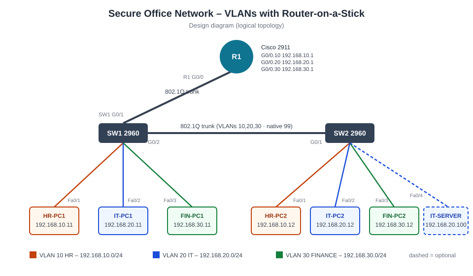

# Secure Office Network Using VLANs – Cisco Packet Tracer

A small office network in Cisco Packet Tracer. Three departments (HR, IT, Finance) are each placed in their own VLAN across two Cisco 2960 switches. A Cisco 2911 router routes traffic between the VLANs using **Router-on-a-Stick** (802.1Q subinterfaces).

## Topology



```
                 [R1 - 2911]
                    G0/0  (802.1Q trunk)
                     |
                    G0/1
 HR-PC1  Fa0/1  [SW1 - 2960] G0/2 ==== trunk ==== G0/1 [SW2 - 2960]  Fa0/1  HR-PC2
 IT-PC1  Fa0/2                                                       Fa0/2  IT-PC2
 FIN-PC1 Fa0/3                                                       Fa0/3  FIN-PC2
                                                                     Fa0/4  IT-SERVER
```

| VLAN | Name | Network | Gateway (R1) |
|---|---|---|---|
| 10 | HR | 192.168.10.0/24 | 192.168.10.1 (G0/0.10) |
| 20 | IT | 192.168.20.0/24 | 192.168.20.1 (G0/0.20) |
| 30 | FINANCE | 192.168.30.0/24 | 192.168.30.1 (G0/0.30) |
| 99 | NATIVE | trunk native VLAN | – |
| 999 | PARKING | unused ports (shut down) | – |

## Features
- VLANs 10/20/30 on both switches. Each department is spread across both switches.
- 802.1Q trunks from switch to switch and from router to switch.
- Inter-VLAN routing with Router-on-a-Stick.
- Hardening: native VLAN 99, DTP disabled (`switchport nonegotiate`), allowed-VLAN lists on trunks, unused ports parked in VLAN 999 and shut down, PortFast on access ports, enable secret and console password.

## Repository Contents
| Path | Description |
|---|---|
| `diagrams/topology.svg` | Logical topology diagram |
| `configs/R1.txt` | Router config (subinterfaces, dot1Q) |
| `configs/SW1.txt` | Switch 1 config |
| `configs/SW2.txt` | Switch 2 config |
| `VLAN_Routing_Project_Report.md` | Full report: addressing, verification commands, tests A–D, troubleshooting, conclusion |
| `*.pkt` | Packet Tracer project file (add after building) |
| `screenshots/` | Topology, VLAN, trunk, subinterface and ping screenshots |

## How to Reproduce
1. In Packet Tracer, place a 2911 router, two 2960-24TT switches and six PCs, then cable them as shown above.
2. Paste each file from `configs/` into the matching device's CLI tab, after `enable` and `configure terminal`.
3. Assign static IPs to the PCs: `.11`/`.12` in each subnet, with the gateway at `.1`.
4. Verify with `show vlan brief`, `show interfaces trunk`, `show ip interface brief`, `show ip route`, and pings within and between VLANs.

> Note: the lab passwords in the configs (`cisco`, `cisco123`) are for demonstration only.
